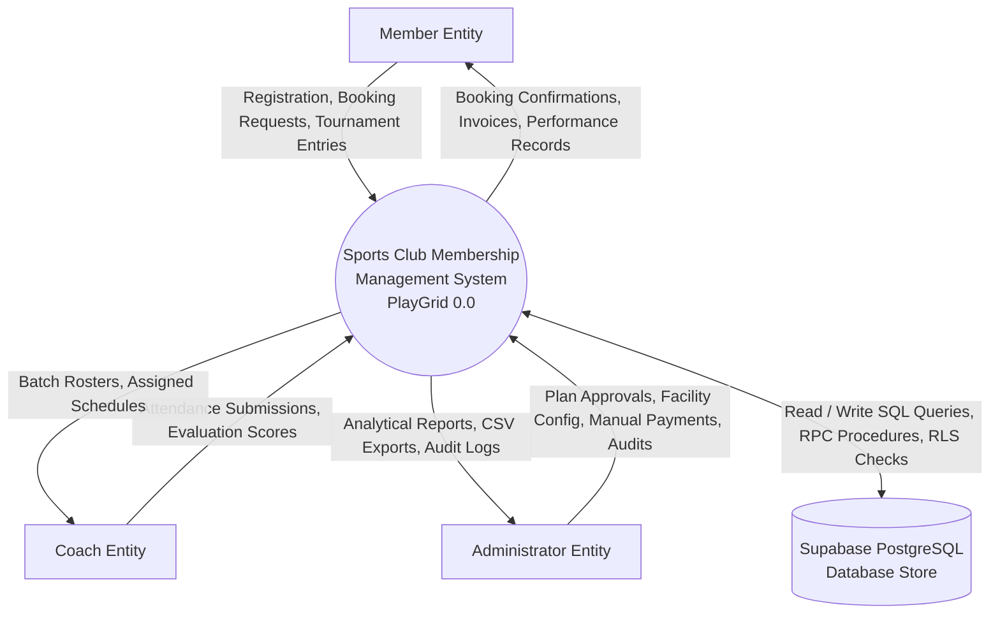
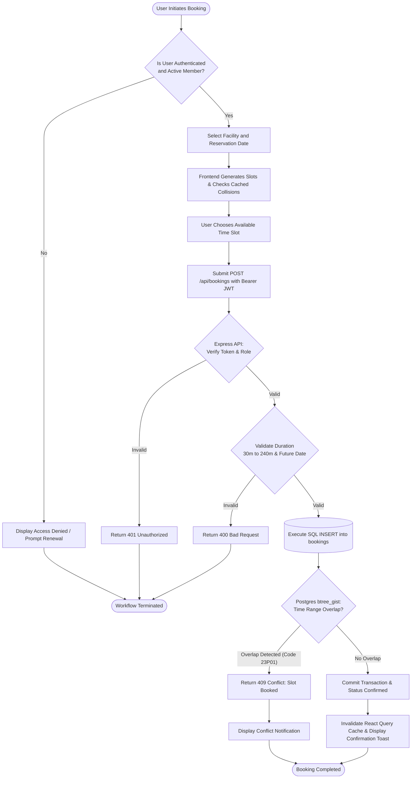
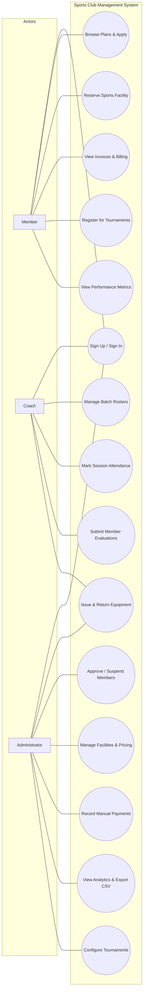
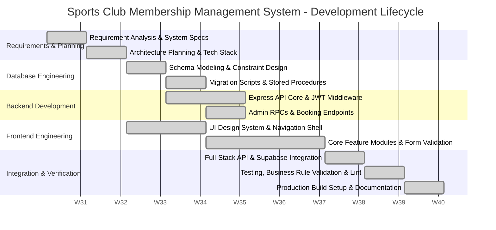

# PROJECT SYNOPSIS

## 1. NAME / TITLE OF THE PROJECT

**Sports Club Membership Management System (PlayGrid)**

The Sports Club Membership Management System (branded internally as PlayGrid) is an integrated, full-stack enterprise web application engineered to centralize and automate athletic club administration. The platform serves three distinct user classes—System Administrators, Certified Sports Coaches, and Club Members—by providing unified interfaces for membership lifecycle operations, facility reservation with conflict prevention, equipment inventory control, coaching batch assignments, attendance rosters, performance evaluation, tournament coordination, and financial accounting. Built on a decoupled Single-Page Application (SPA) architecture backed by a Node.js REST API and Supabase PostgreSQL infrastructure, the system eliminates administrative overhead, eradicates scheduling collisions, and establishes transparent communication across all sporting facilities.

---

## 2. STATEMENT ABOUT THE PROBLEM

Traditional sports club operations frequently depend on manual registers, decentralized spreadsheets, and informal communication channels. This operational paradigm introduces systemic vulnerabilities across core functions:

1. **Temporal Reservation Conflicts:** In multi-sport facilities with high court and pitch turnover, manual booking logs routinely suffer from double-booking errors, scheduling ambiguities, and lack of real-time court availability enforcement.
2. **Membership Lifecycle Inefficiencies:** Manual processing of membership registrations, renewal dates, sequence tracking, and tier upgrades causes revenue leakage, delayed onboarding, and administrative backlog.
3. **Inventory Discrepancies and Equipment Loss:** Sports equipment checkouts and returns without concurrency-controlled stock deduction lead to inventory mismatches, unaccounted damages, and untracked member liabilities.
4. **Disjointed Athletic Tracking:** Coaches lack centralized tools to manage batch rosters, verify member eligibility, record session-level attendance, and document empirical performance evaluations.
5. **Absence of Unified Financial & Audit Visibility:** Cash and manual receipt tracking across multiple club activities impairs financial auditability and limits managerial insights into revenue trends and facility utilization.

To overcome these challenges, a centralized, role-segregated digital system with database-enforced integrity constraints is necessary.

---

## 3. WHY THE PARTICULAR TOPIC WAS CHOSEN

The management of physical sports facilities presents unique challenges in relational database integrity and concurrent transaction management. Unlike basic record-keeping applications, athletic facility systems require:
- Mathematical exclusion handling for time-slot reservations.
- Concurrency control for finite physical assets.
- Strict role-based security boundaries.

Academically and practically, this project illustrates the synthesis of modern web engineering:
- Implementing pessimistic row-level locking (`FOR UPDATE`) within PostgreSQL stored procedures to eliminate checkout race conditions.
- Leveraging generalized search tree (`btree_gist`) exclusion constraints to enforce temporal collision prevention directly at the database engine level.
- Decoupling user interface reactivity using TanStack Query while securing backend endpoints through JWT validation and Row-Level Security (RLS).

Designing and implementing this system provides an end-to-end demonstration of resilient database architecture, full-stack TypeScript engineering, and scalable web application development.

---

## 4. OBJECTIVES AND SCOPE OF THE PROJECT

### 4.1 Primary Objective
To design, implement, and validate an integrated, role-based sports club management platform that digitizes member onboarding, automates conflict-free court and facility scheduling, governs sports gear transactions, coordinates coaching operations, and provides financial analytics.

### 4.2 Specific Objectives
1. **Implement Role-Based Access Control (RBAC):** Authenticate users and enforce granular access policies across three distinct user roles: Administrator, Coach, and Member.
2. **Automate Membership Lifecycle Management:** Provide sequential membership identifier generation (`MEM-00XXXX`), plan-driven duration calculation, administrative approval flows, and account suspension mechanisms.
3. **Deliver Conflict-Free Facility Scheduling:** Build an interactive reservation module backed by database-level temporal exclusion constraints to prevent overlapping reservations.
4. **Establish Concurrency-Controlled Equipment Inventory:** Implement transactional issuing and return mechanisms using PostgreSQL stored procedures to preserve stock consistency.
5. **Streamline Coaching and Athletic Progress:** Enable coach batch assignments, session-by-session attendance tracking, and quantitative member performance evaluations.
6. **Provide Financial and Operational Analytics:** Maintain transaction ledgers with receipt tracking, live metric dashboards, and audit-compliant CSV reporting.

### 4.3 Scope Boundaries
- **In-Scope (Current Implementation):** Single-organization multi-sport club operations; user authentication and profile management; plan creation and approvals; real-time facility slot booking; equipment check-in/check-out; attendance rosters; numerical skill scoring (0–100); tournament registration; in-app notifications and announcements; administrative metric visualizations and CSV exports.
- **Out-of-Scope (Future Enhancements):** Multi-tenant federation across independent clubs; live external payment gateway processing (e.g., Stripe, Razorpay); automated external SMS/SMTP dispatch; automated tournament bracket/fixture generation engines.

---

## 5. METHODOLOGY AND PROCESS DESCRIPTION

### 5.1 Architecture Overview
The system follows a three-tier decoupled client-server architecture:
- **Presentation Tier:** A React Single Page Application (SPA) built with Vite, TypeScript, and Tailwind CSS.
- **Application Tier:** An Express 5.0 REST API server running on Node.js in TypeScript, orchestrating business logic and privileged administrative routines.
- **Data Tier:** Supabase PostgreSQL with built-in Supabase Auth, Row-Level Security (RLS), and database-level stored functions.

```
+-------------------------------------------------------------+
|                      PRESENTATION TIER                      |
|           React 19 + TypeScript + Vite + Tailwind CSS       |
|    TanStack Query (State & Cache) | React Router v7 (RBAC)  |
+------------------------------+------------------------------+
                               |
            +------------------+------------------+
            | (REST / JWT)                        | (PostgREST / SDK)
            v                                     v
+-----------------------------+     +-----------------------------+
|      APPLICATION TIER       |     |          DATA TIER          |
|  Node.js Express 5.0 API    |     |    Supabase PostgreSQL      |
|  - Bearer JWT Validation    |====>|  - 14 Relational Tables     |
|  - Membership Approval Flow |     |  - Row Level Security (RLS) |
|  - Inventory RPC Proxies    |     |  - btree_gist Constraints   |
|  - Static Production Host   |     |  - Supabase Auth Service    |
+-----------------------------+     +-----------------------------+
```

### 5.2 Module Description
1. **Authentication & Identity:** Supabase Auth handles email/password credentials and password reset flows. A PostgreSQL trigger (`handle_new_user`) initializes the `profiles` and `members` tables on registration.
2. **Membership Administration:** Supports administrative plan authoring and approval. When approved, a PostgreSQL sequence allocates an incremental membership number (`generate_membership_number()`).
3. **Facility & Court Booking:** Calculates available slots based on operating hours and existing bookings. Persistence is guarded by a PostgreSQL `btree_gist` exclusion constraint:
   $$\text{EXCLUDE USING gist } (\text{facility\_id WITH } =, \text{tstzrange}(\text{start\_time}, \text{end\_time}) \text{ WITH } \&\&)$$
4. **Equipment Inventory:** Tracks sports inventory across categories. Transactional RPCs (`issue_equipment` and `return_equipment`) lock records using `FOR UPDATE` to prevent stock race conditions.
5. **Coaching, Batches, & Attendance:** Coaches manage scheduled training batches and mark individual athlete attendance (`present`, `absent`, `late`).
6. **Performance Evaluation:** Coaches log athletic metrics and numerical evaluations (0–100) visible on member profiles.
7. **Tournaments & Engagement:** Administrators publish tournaments and broadcast role-targeted club announcements.
8. **Financial Ledgers & Reports:** Records transaction references (`DEMO-XXXXXXXX`), displays monthly revenue trends with Recharts, and generates client-side CSV exports for members and payments.

### 5.3 Architectural Diagrams

#### A. Level-0 Data Flow Diagram (DFD)


#### B. Primary Workflow: Facility Booking & Collision Validation Flowchart


#### C. Role-Based Use-Case Diagram


---

## 6. HARDWARE AND SOFTWARE REQUIREMENTS

### 6.1 Hardware Specifications
*All client and server specifications represent estimated minimum operational baselines.*

| Parameter | Client / End-User Machine (Estimated) | Development / Host Server (Estimated) |
| :--- | :--- | :--- |
| **Processor** | Dual-Core 1.8 GHz Intel Core i3 / AMD Ryzen 3 or equivalent | Quad-Core 2.4 GHz 64-bit x86/ARM Processor |
| **RAM** | 4 GB DDR4 | 8 GB DDR4 (4 GB minimum for single-instance Node.js) |
| **Storage** | 500 MB free space (Browser cache and assets) | 20 GB SSD storage (OS, Node dependencies, build assets) |
| **Network** | Broadband Internet connection ($\ge 2\text{ Mbps}$) | High-speed dedicated network ($\ge 100\text{ Mbps}$ uplink) |
| **Display** | $1280 \times 720$ minimum resolution (responsive design) | Headless / Terminal administration console |

### 6.2 Software Specifications
*Versions verified directly from repository configuration files (`package.json`, `tsconfig.json`).*

| Layer / Role | Technology / Specification | Verified Repository Version |
| :--- | :--- | :--- |
| **Operating System** | Cross-Platform (Windows 10/11, Ubuntu 22.04 LTS, macOS) | System Independent |
| **Programming Languages** | TypeScript / ECMAScript 2022 | TypeScript `~6.0.2` |
| **Frontend Framework** | React (Single Page Application) | React `^19.2.8` |
| **Client Bundler & Tooling** | Vite with Fast Refresh plugin | Vite `^8.3.0` |
| **Styling & Design System** | Tailwind CSS with PostCSS | Tailwind CSS `^4.3.3` |
| **Client Routing & State** | React Router DOM & TanStack React Query | React Router `^7.18.4`, React Query `^5.104.1` |
| **Backend Framework** | Node.js Express Framework | Express `^5.3.0` |
| **Server Runtime** | Node.js (with `tsx` execution engine) | Node.js `v18+` (npm `v9+`), `tsx ^4.23.15` |
| **Database & Auth** | Supabase PostgreSQL with Supabase Auth | PostgreSQL `15+`, `@supabase/supabase-js ^2.117.3` |
| **Static Code Quality** | Oxlint fast linter & Vitest unit testing framework | Oxlint `^1.81.0`, Vitest `^5.0.3` |
| **Deployment Model** | Single-service Node.js deployment serving static assets | Express static file hosting of `/dist` build |

---

## 7. CONTRIBUTION OF THE PROJECT

The implementation delivers concrete operational and technical contributions:

1. **Guaranteed Double-Booking Elimination:** Through the integration of the PostgreSQL `btree_gist` index and time-range exclusion constraints, physical facility scheduling conflicts are resolved deterministically at the database level rather than through fragile client checks.
2. **Transactional Integrity for Physical Inventory:** Using explicit row-level locks (`SELECT ... FOR UPDATE`) inside database stored procedures, the equipment issuance module prevents negative inventory states during concurrent checkout requests.
3. **Comprehensive Operational Unification:** The system consolidates membership processing, coach batch scheduling, attendance logging, tournament registration, and billing ledgers into a single role-guarded web platform.
4. **Enhanced User Experience and Performance:** The client interface utilizes optimistic updates, caching via TanStack Query, dark-mode styling, and accessible responsive layouts that reduce administrative friction across both desktop and mobile viewports.
5. **Auditable Administrative Control:** System actions generate persistent audit log entries, while managers can generate real-time visual trend lines and download filtered CSV exports for external compliance.

---

## 8. PROJECT SCHEDULE — GANTT CHART

The following schedule reflects a standard 10-week academic development lifecycle for full-stack engineering, structured across conceptual planning, database migration authoring, service integration, and verification.



### Development Schedule Table
*Schedule labeled as a standard proposed academic development timeline.*

| Phase | Duration | Core Deliverables & Milestones |
| :--- | :--- | :--- |
| **Week 1: Requirements Gathering** | 7 Days | Software requirements specification (SRS), user persona definitions, problem identification. |
| **Week 2: Architectural Modeling** | 7 Days | System architecture diagram, database entity relationship diagram (ERD), API specification. |
| **Week 3: Database Engineering** | 7 Days | Supabase migrations (00 to 02), table definitions, `btree_gist` exclusion constraint configuration. |
| **Week 4: Advanced DB & Backend** | 7 Days | Migrations (03 to 05), stored procedures (`issue_equipment`, `generate_membership_number`), Express setup. |
| **Week 5: Backend API & Auth** | 7 Days | Bearer JWT authentication middleware, role validation, member approval and manual payment routes. |
| **Week 6: Frontend Core & Layout** | 7 Days | Vite React project setup, Tailwind CSS theme, responsive navigation shell, Supabase client wrapper. |
| **Week 7: Management Modules** | 7 Days | Members list, profile views, facility directory, interactive calendar slot booking components. |
| **Week 8: Inventory & Coaching** | 7 Days | Equipment inventory management, batch attendance rosters, performance evaluation screens. |
| **Week 9: Reports & Integration** | 7 Days | Recharts data analytics, CSV export engine, full-stack endpoint linking with TanStack Query. |
| **Week 10: Testing & Documentation** | 7 Days | Vitest business rule validation, Oxlint code analysis, production build verification, synopsis preparation. |

---

## 9. RESOURCES AND LIMITATIONS

### 9.1 Development and Runtime Resources
- **Development Environment:** Visual Studio Code / modern IDE, Git version control, PowerShell terminal.
- **Runtime Environment:** Node.js v18+ runtime, npm package ecosystem.
- **Backend-as-a-Service Infrastructure:** Supabase cloud project providing managed PostgreSQL 15 and Supabase GoTrue Auth.
- **Testing Tools:** Vitest testing suite and JSDOM browser simulation.

### 9.2 Technical and Implementation Limitations
1. **Mock Payment Architecture:** The financial module records manual cash and simulated transactions (issuing randomized references such as `DEMO-XXXXXXXX`). Live third-party payment gateways (e.g., Stripe, PayPal, Razorpay) are not integrated.
2. **Simulated Receipt Generation:** The endpoint `/api/payments/:id/receipt` provides a structured simulation response rather than generating a binary PDF document via server-side rendering libraries (e.g., PDFKit).
3. **In-App Notification Scope:** Alerts and global announcements are persisted directly in PostgreSQL tables and queried via client hooks. External dispatch systems (such as SMTP email reminders or SMS webhooks) are not implemented.
4. **Single-Organization Boundary:** The current database schema is designed for a single sports club organization and does not support multi-tenant club federation.
5. **Tournament Brackets:** Tournaments support participant registration and capacity enforcement, but automated round-robin or knockout fixture bracket generation is left for future iterations.

---

## 10. CONCLUSION

The Sports Club Membership Management System (PlayGrid) successfully addresses the operational bottlenecks of manual club administration through a modern, cloud-native web application. Grounded in robust database engineering, the platform implements database-level temporal exclusion constraints to prevent court double-bookings and pessimistic row-level locking to safeguard sports inventory from concurrent checkout anomalies.

By uniting member lifecycle administration, coach training batches, attendance rosters, quantitative evaluation metrics, and financial reporting into an integrated, role-governed user interface, the application eliminates manual overhead and improves data transparency. Developed with a high-performance stack comprising React 19, Vite, Express 5, and Supabase PostgreSQL, the system demonstrates modern best practices in software architecture, type safety, and relational data design, providing a solid foundation for future extensions such as live payment processing and external messaging services.

---

## 11. REFERENCES / BIBLIOGRAPHY

1. React Documentation Team, "React: The library for web and native user interfaces," Meta Open Source, 2026. [Online]. Available: https://react.dev/
2. Node.js Documentation Team, "Node.js v18 and v20 LTS Documentation," OpenJS Foundation, 2026. [Online]. Available: https://nodejs.org/en/docs/
3. Express.js Project, "Express 5.x API Reference," OpenJS Foundation, 2026. [Online]. Available: https://expressjs.com/
4. Supabase Documentation, "PostgreSQL Database, Auth, and Storage Architecture," Supabase Inc., 2026. [Online]. Available: https://supabase.com/docs
5. The PostgreSQL Global Development Group, "PostgreSQL 15 Documentation: Exclusion Constraints and btree_gist Extension," PostgreSQL Global Development Group, 2026. [Online]. Available: https://www.postgresql.org/docs/15/sql-createtable.html
6. Vite Core Team, "Vite: Next Generation Frontend Tooling," Vite Documentation, 2026. [Online]. Available: https://vite.dev/
7. TanStack, "TanStack Query v5: Powerful asynchronous state management for TS/JS," TanStack, 2026. [Online]. Available: https://tanstack.com/query/latest
8. Tailwind Labs, "Tailwind CSS Documentation: Rapidly build modern websites," Tailwind Labs Inc., 2026. [Online]. Available: https://tailwindcss.com/docs
9. Microsoft, "TypeScript Documentation: JavaScript With Syntax For Types," Microsoft Corporation, 2026. [Online]. Available: https://www.typescriptlang.org/docs/
10. R. S. Pressman and B. R. Maxim, *Software Engineering: A Practitioner's Approach*, 9th ed., New York, NY, USA: McGraw-Hill Education, 2020.
11. I. Sommerville, *Software Engineering*, 10th ed., Boston, MA, USA: Pearson, 2016.
