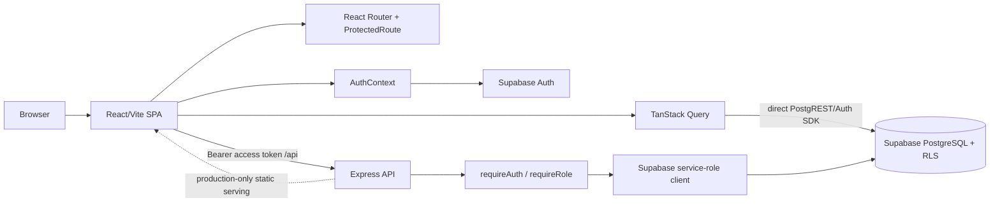

# Technical architecture

## Initialization and boundaries

`index.html` loads `src/main.tsx`, which renders `App` into `#root` under `StrictMode`. `App` constructs one default `QueryClient`, wraps the route tree in `AuthProvider`, and configures Sonner. `src/app/router.tsx` creates the browser router. The Vite dev server proxies `/api` to port 5000; direct Supabase traffic does not pass through Express.

## Routing and navigation

The root protected route wraps `MainLayout`; nested route guards constrain members, plans, coaches, facilities, bookings, and reports. Several routes render for any authenticated account and rely on page UI plus RLS for effective permissions. `MainLayout` filters its sidebar by profile role and renders the child outlet. There is no catch-all React route or router error element.

## Data and state

There is no global domain store. `AuthContext` owns user/session/profile/loading. React Query owns feature query caches and invalidates prefix keys after mutations. Form state is local React state except facilities and plans, which use React Hook Form with Zod resolvers. Most errors reach Sonner via mutation callbacks; query errors are generally thrown to React Query without route-level error UI.

## Request lifecycle

For booking: UI selects a slot -> `BookingsPage` sends a session bearer token to `/api/bookings` -> `requireAuth` validates it with Supabase Admin -> server validates active membership/facility, computes fee, inserts booking -> PostgreSQL exclusion constraint prevents overlapping pending/confirmed reservations -> JSON response triggers query invalidation. Direct-update paths (for example member cancelling a booking) instead rely on the browser client and RLS.

## Server operation

`server/index.ts` listens on `PORT` (default 5000). `server/app.ts` loads dotenv, enables permissive CORS and JSON parsing, mounts five routers, offers `/api/health`, then 404s unmatched APIs. Only when `NODE_ENV=production` does it serve `../../dist` and fall back to the SPA. The service-role client is initialized from `VITE_SUPABASE_URL` and `SUPABASE_SERVICE_ROLE_KEY`.

## Constraints and interpretation

The design appears intentionally hybrid: fast direct Supabase CRUD where RLS can express access, and server mediation for privileged/transactional actions. That interpretation is supported by code, but server-side validation is not uniformly applied. Static-host deploy config makes the server boundary unavailable unless a separate API deployment/rewrite is added.
