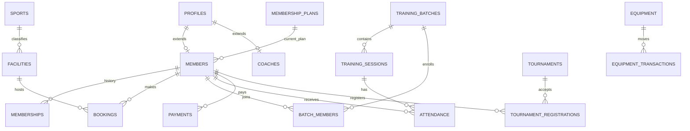

# Data model and persistence

Six ordered migrations define the database. They must be applied in filename order. Supabase Auth owns `auth.users`; `profiles` is a one-to-one public extension created by `handle_new_user`.

## Objects by migration

- `...00000_init_roles_auth.sql`: enums `app_role`, `member_status`; profiles, plans, members, coaches; profile signup trigger; RLS. `members.id`/`coaches.id` reference profile IDs.
- `...00001_memberships.sql`: historical `memberships`, membership number sequence/function, role-sensitive RLS.
- `...00002_facilities_and_bookings.sql`: sports, facilities, operating hours, blocked periods, bookings and `booking_status`. A GiST exclusion constraint stops overlapping pending/confirmed bookings for a facility.
- `...00003_payments_and_equipment.sql`: payments, equipment, equipment transactions; `issue_equipment`/`return_equipment` lock rows to protect inventory changes.
- `...00004_batches_and_attendance.sql`: training batches/members/sessions, attendance (unique session/member), evaluation score check 0–100.
- `...00005_tournaments_and_extras.sql`: tournaments, unique member registrations, announcements, notifications, audit logs.

## RLS and lifecycle

Most SELECT policies allow all authenticated users only where appropriate; members usually see only their records, and admin/coach policies grant operational visibility. CRUD policy expressions generally test `profiles.role`. The server service role bypasses these policies and therefore must keep its key private. Sign-up creates a pending member, admin approval assigns a plan and history record, and expiry is stored as a date; no observed scheduled process changes expiry statuses.

## Schema/code concerns

The client reads `facilities` as a coach although RLS only permits admin writes, so coach edit UI will fail. Booking server validation checks past time but does not call the existing `isValidDuration`, validate ordering, operating hours, blocked periods, or membership plan expiry. `audit_logs` and `announcements` have schema/RLS but no observed writers/readers in the app.
